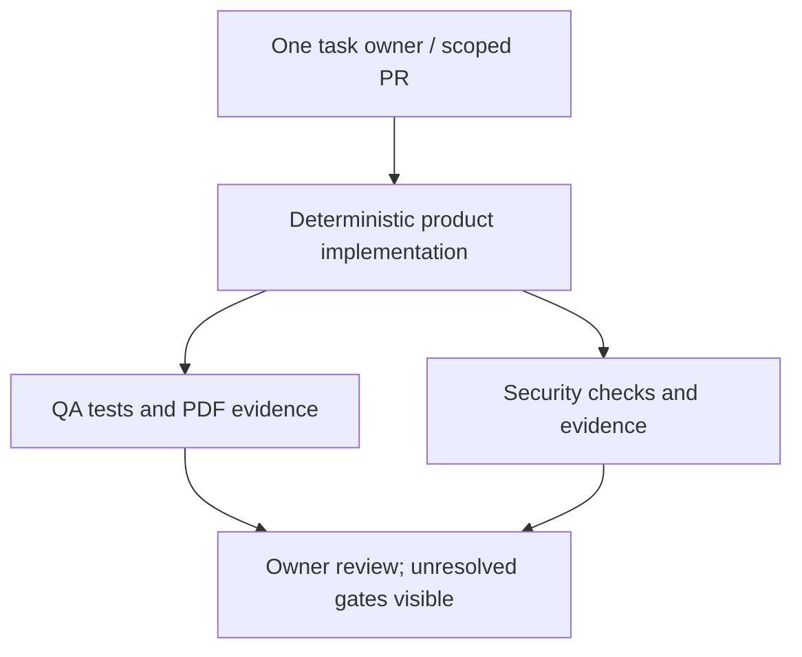

# Sirati agent architecture audit V1 — 2026-10-11

## Evidence boundary and conclusion

Base: `2d464852dc11a98b2ab4d1bb05388b25eaaeaaf1` (main, retrieved live). Nine named contributor roles; **zero executable autonomous AI agents and zero tool-using LLM workflows found** in the repository or reconstructed runtime. Do not equate this with proof that no external automation exists anywhere. A read-only lookup of the connected account's task automations found no Sirati task; no external service was changed.

Inventoried all 128 tracked paths and inspected relevant agent/execution code, the 41-entry encoded source archive, generated app/components/lib, package manifest, six workflows, role/policy/board/history documents and current open PR metadata. `prepare_pages.py` invokes 54 sequential generator hooks. These are deterministic Python patch scripts, not agent invocations. Browser suggestions use local regex/curated content and user selections, not paid inference. `source.part4` is not in the current reconstruction list; no archive part or historical generator was deleted.

Live source-of-truth correction: PR #131 is merged and current main includes the searchable bilingual PDF/punctuation fix. Historical open #114/#126 descriptions are not current production status. PRs #96, #114, #115, #116, #117 and #126 were inspected for overlap; none merged into this branch. Product/PDF generators and archived source remain unchanged.

Verified GitHub records (prior evidence, not this branch's acceptance):
- Main manual Pages run: https://github.com/Abdulrahmanelsayyad/sirati/actions/runs/38163662803 — success at exact base SHA.
- Release PR https://github.com/Abdulrahmanelsayyad/sirati/pull/131 head `25b29f883edfd09797bbc974c0acf2224844479e`: Build 38161310709, E2E 38161310588, staging **build-only** 38161310544 and PDF 38161310717 all success.
- No live customer session/data accessed. Prior owner's A/B claim in #131 is historical testimony, not a live test performed in this audit.

## Inventory and disposition

Every name below comes from `AGENT_TEAM.md` (numbered historical role), with instructions in `AGENT_SKILLS.md`, boundaries in `AGENT_POLICY.md`, manual communication in `AGENT_BOARD.md`, and historical claims in `AGENT_CHANGELOG.md`/`AGENT_LESSONS.md`.

| Exact role | Intended purpose | Related real implementation (not its agent code) | Decision and justification |
|---|---|---|---|
| Sirati Manager | Priorities, routing, closeout | Board/PR ownership only; no dispatcher | MERGE with Deputy into one task owner; no execution engine to refactor |
| Sirati Deputy Manager | Continuity, handoffs, overlap detection | Board only; no lock/queue/lease | MERGE coordination responsibility; preserve alias/history |
| Sirati Design Agent | Layout/mobile/RTL/templates | `.github/scripts/*template*.py`, `mobile_builder_fix.py`; generated `components/CvPreview.tsx` | MERGE into product implementation specialty; retain functioning renderers |
| Sirati Security Agent | Security review | `qa/account_storage_check.py`, `qa/pdf_order_policy_static_check.py`, `qa/supabase_rls.sql`, `.github/workflows/pdf-order-security.yml` | UPGRADE deterministic verification; keep security result distinct from implementer approval |
| Sirati Bug Fixer | Reproduce/repair defects | Sequential generator hooks, `qa/new_cv_regression.cjs` | MERGE into product task owner; do not create autonomous write executor |
| Sirati Customer Liaison | Support signals/replies | `.github/scripts/support_section.py`, mailto link | RETIRE unsupported autonomous-monitoring claim; retain manual support and address; no external task stopped |
| Sirati CV Expert | Factual CV guidance | `smart_nursing_library.py`, `experience_description_picker.py`, `career_description_upgrade.py`, `personal_summary_picker.py`, `smart_content_suggestions.py`, `smart_cv_pro_v4/v5/v6.py` | KEEP useful deterministic content functionality; contributor specialty, not an AI service |
| Sirati QA & Release Agent | Journey/PDF verification | `qa/e2e.mjs`, `qa/print_regression.mjs`, `qa/pdf_*`, QA workflows | UPGRADE bounded evidence contract; release permission is separate |
| Sirati Performance & SEO Agent | Speed/SEO/accessibility | Template/home scripts; `qa/pdf_release_run.sh` size/timing comparison | MERGE into product review specialty; no continuous performance agent found |

No separately implemented Development, PDF/ATS, Security or Manager inference service found. PDF/ATS is a deterministic exporter plus substantial real regression code. `CvReadinessCheck.tsx` is a read-only weighted heuristic with an explicit non-ATS-vendor-score disclaimer. It is not an AI QA agent.

### Shared execution attributes for the nine roles

1. Exact purpose/identity/source: table above; role prompts are Markdown instructions only.
2. Entry/trigger: no executable role entrypoint. Design says “Runs daily” without a matching repository schedule. Real builds trigger on PR/push/manual workflows; product components trigger on user interaction.
3. Models/system prompts/inference: no model SDK, model name, backend inference endpoint, tool-calling loop or per-role inference configuration found. Markdown playbooks are instructions for contributors.
4. Tools/permissions: prose policy only, not per-agent runtime ACLs. CI uses `contents: read`; the existing manual Pages deployment job separately grants pages/id-token write, gated to main and explicit approval. This PR does not change those permissions.
5. Dependencies/services: product uses Next 16.3.8, React 19.2.0, Supabase JS 2.117.2, html2canvas 1.4.1, pdf-lib 1.17.1/fontkit, local Noto fonts; GitHub CI; Netlify staging config. No new runtime dependency introduced.
6. Inputs/outputs: contributors read files/issues and propose patches; local suggestions read role/language and user-entered facts, output editable text; QA consumes reconstructed code/synthetic fixtures and emits logs/artifacts. No CVs sent to an inference provider in inspected code.
7. Communication: board/PR handoffs, not agent messages, queues or RPCs. Some historical board tasks even list two owners; prose is not an enforced lock.
8. Failure/recovery: generator `subprocess.run(check=True)` stops at failure; CI job failure, assertions and manual triage; no agent retry/timeout/escalation state machine.
9. Monitoring: GitHub logs/artifacts and manually maintained Markdown; no agent execution IDs, run history or model telemetry.
10. Useful execution evidence: build, tests and CI actually execute; no evidence tying those successes to autonomous execution of the nine named roles.
11. Cost: no app inference call sites found. No model token/API spend telemetry or external billing available. Do not convert this into an invented dollar saving.

## Evidence-based technical scorecard

Scores assess the **claimed autonomous role implementation**, not the value of related scripts. Rubric: 0 = no verified implementation/evidence for that dimension; 1 = prose-only provision; 2 = partial executable capability; 3 = tested common path; 4 = substantial tested integration; 5 = comprehensive evidence. Business usefulness is a reasoned judgment of the documented responsibility, not a measured KPI. Zero here is not a claim that the entire product is insecure or useless. Assigning the E2E suite's success to an unimplemented LLM agent would be misleading.

B=business usefulness, F=functionality, C=code/maintainability, S=security boundaries, R=reliability, I=integration, T=tests/observability, P=performance efficiency.

| Role | B | F | C | S | R | I | T | P | /40 |
|---|---:|---:|---:|---:|---:|---:|---:|---:|---:|
| Manager | 4 | 0 | 0 | 1 | 0 | 0 | 0 | 0 | 5 |
| Deputy | 2 | 0 | 0 | 1 | 0 | 0 | 0 | 0 | 3 |
| Design | 4 | 0 | 0 | 1 | 0 | 0 | 0 | 0 | 5 |
| Security | 5 | 0 | 0 | 1 | 0 | 0 | 0 | 0 | 6 |
| Bug Fixer | 5 | 0 | 0 | 1 | 0 | 0 | 0 | 0 | 6 |
| Customer Liaison | 2 | 0 | 0 | 1 | 0 | 0 | 0 | 0 | 3 |
| CV Expert | 4 | 0 | 0 | 1 | 0 | 0 | 0 | 0 | 5 |
| QA & Release | 5 | 0 | 0 | 1 | 0 | 0 | 0 | 0 | 6 |
| Performance & SEO | 3 | 0 | 0 | 1 | 0 | 0 | 0 | 0 | 4 |

Justifications: Security/QA/Bug Fixer address demonstrated privacy/PDF/regression risks; Manager has useful scope ownership but Deputy duplicates it; Design/CV content have concrete product counterparts; Performance is useful but secondary at current scale; Liaison has only a link with no verified connected inbox. All share prose protected-area restrictions (S=1); no executable per-role boundary, tests or measured latency exists to award remaining points.

## Lean target and orchestration decision

**Zero autonomous agents are currently necessary. Three responsibility lanes are sufficient; they are not three new services:**

- One implementation owner: coordinates scope and existing deterministic product modules; absorbs Manager/Deputy and product specialties.
- QA verification: existing browser, build, PDF and synthetic regression checks.
- Security verification: credential boundary, npm audit, account source/behavior contracts and isolated PostgreSQL CI. Security success cannot be inferred from visual QA success.

Owner review follows both verification lanes. A human or separate review session can supply independent judgment; an implementer's report cannot substitute for it. This audit used a separate read-only reviewer for the new verifier only, not full release signoff.



Manager capabilities: routing/ownership/dependencies are presently manual; no automatic deduplication, completion validation, retry handling, failed-agent detection or loop control. A new LLM manager would add cost without an execution need. Retain GitHub PR/CI lifecycle and fixed commands. One branch owner, one explicit scope, no competing product writes; reviewers return defects to that owner. No recursive delegation/tool executor, no model-generated shell commands, zero retries in the new runner, 90-second child-check timeouts, 30-minute existing QA job cap. The runner is **trusted local tooling, not a process/network sandbox or distributed lock**.

Handoff contract: task ID, owner, base/head SHA, touched files/scope, reproducible commands, structured status, evidence artifact, failures/not-run gates and next reviewer. A report covers its checks only; never marks live RLS/browser/PDF-reader tests passed when not run. No failure automatically merges, deploys, retries a write or mutates infrastructure.

## Implemented changes

- `qa/verification.py`: fixed allowlisted sequence reuses existing account, duplicate, static SQL and PDF-boundary tests. No dynamic tool routing or external services. Distinct PASS/FAIL/TIMEOUT/BLOCKED per check; aggregate fails closed. Input SHA-256 before/after prevents reporting success across detected input changes; Git SHA and source digest both recorded.
- Supplemental client boundary rules detect server Supabase secrets, privileged service-role JWTs, private keys, selected provider token formats and public privileged env references in generated app/components/lib/public, including binary assets. Publishable/anon keys remain valid. Only rule/path/line is reported, never matched values. This is deliberately **not** a replacement for general secret scanning, historical Git scanning, SAST or live RLS verification.
- Fixed child commands inherit a small environment allowlist, not backend credentials. Failure reports retain allowlisted exception classes and reproduction commands without raw output. Old output is removed before checking input, preventing stale PASS reuse.
- `qa/test_verification.py`: ten tests with adversarial subcases for privileged/public credentials, malformed JWTs, binary assets, symlinks, empty source, failed/missing/timed-out commands, environment isolation, stale success and changed-input failure.
- Existing `.github/workflows/qa.yml`: reuse runner instead of duplicate static invocations; add runner regression tests, JSON artifact, 30-minute bound and established `npm audit --audit-level=high`. No permission expansion, deployment step, new service, DB or runtime dependency.
- `AGENT_TEAM.md`, `AGENT_POLICY.md`, `AGENT_BOARD.md`: distinguish role names from actual runtime, consolidate coordination, remove implicit deployment/rollback authority and retain historical aliases/dependencies.
- No product/PDF, auth/session implementation, schema, payment, customer data, external schedules or secrets changed.

## Verification and benchmark evidence

Local environment: Node 24.19.0, Python 3; CI uses Node 22. Local reconstruction followed the existing archive + prepare_pages + print_isolation pipeline. No backend configured for local build. Zero reported vulnerabilities from the installed dependency snapshot; npm audit is point-in-time and depends on registry advisory coverage.

| Check | Result |
|---|---|
| Existing account/draft suite before/after | PASS: eight new-CV cases, synthetic cleanup/signout; no real-account claim |
| Existing duplicate-CV source invariants | PASS before/after |
| Existing PDF-order static SQL contracts | PASS before/after; not PostgreSQL execution |
| Existing PDF boundary behavior | PASS: 42 fractional boundary cases + edge/cascade/fail-closed assertions |
| New verifier regression suite | 10/10 PASS; independent reviewer reran same suite |
| Generated production build / TypeScript build validation | PASS locally |
| npm audit before Playwright install | PASS: 0 known vulnerabilities, reported dependency total 93 |
| Existing full browser E2E | PASS locally: `E2E QA COMPLETE`; Chromium 140 / Playwright 1.55.0, synthetic localhost build |
| Fresh full PDF native-reader matrix | NOT RUN: product/export code unchanged; prior exact release CI linked above |
| Live accounts, live RLS, real Android, universal ATS/PDF-UA | NOT RUN / not certified by this work |

Independent reviewer initially found post-test-only fingerprinting, stale-report risk and insufficient failure diagnosis; changes addressed them and re-review found no blocking verifier defect in its trusted-local scope. Remaining limitations: temporary child log spool not size-capped, unexpected I/O/Git error exits without structured report (old report invalidated), reproducible argv is safe only because commands are fixed and credential-free. No blanket product Security/QA signoff.

Measured identical eight synthetic public-file exposure fixtures against old three-check CI set and new boundary check: **old detected 0/8; new detected 8/8**. These fixtures are not eight real vulnerabilities and do not estimate general vulnerability recall. Same existing functional cases still pass. No credentials committed; synthetic probe removed after benchmark.

20 local runs on unchanged reconstructed input, no warm-up exclusion:

| Suite | Mean ms | p95 ms | Passed runs |
|---|---:|---:|---:|
| Existing three static/synthetic checks | 274.57 | 284.99 | 20/20 |
| Four checks + client boundary scan | 386.61 | 438.53 | 20/20 |

Microbenchmark excludes report/fingerprint overhead and build/browser work. Coverage increased with ~112 ms mean overhead here; no latency reduction claimed. Historical autonomous-agent latency/tokens/cost/failure rate: unavailable. No new inference calls, databases, queues, frameworks, production packages or subscriptions. Existing deterministic suggestions retained, so no invented reduction from an already-zero observed inference path.

## Remaining risks and release boundaries

| Priority | Risk / follow-up |
|---|---|
| P1 | Do not treat this source/synthetic audit as current live account/RLS confidentiality verification. Separate owner-authorized synthetic-account acceptance and independent release review remain required for future sensitive changes. |
| P2 | Generator/archive architecture and no tracked reproducible generated dependency lock make source review/supply-chain verification harder; 54 sequential patches with evolving assumptions. Migrate separately with parity tests, not here. |
| P2 | Existing Actions use mutable major-version tags; no general repository/history secret scanner or full SAST added. Supplemental patterns do not detect all token formats/obfuscations/logging leaks. |
| P2 | Existing PDF release guard uses historical baseline/scope assumptions. Agent-only change should not trigger/rewrite it; broad combined releases need explicit scope redesign and fresh native-reader matrix. |
| P2 | Local curated suggestions require user truth review; they cannot verify real employment/licensure/outcomes. Do not call readiness heuristics validated ATS scores. |
| P3 | Historical Markdown board is stale in places and not a lock; external integration inventory outside available account is unknown. No external service retired. |
| P3 | New verifier scans/hashes whole files; runner subprocess timeout and CI job bound are not per-file memory limits. Captured temporary logs can grow until timeout. |

No P0 newly verified. Existing risks are scoped findings, not claims of exploitable production defects. Draft readiness means reviewable code/evidence, not deployment approval. Before production: review exact PR diff/head CI, resolve relevant release gates, obtain owner merge/deploy authorization; for future product/PDF changes repeat native reader and device acceptance. This branch does not need a production deployment to be useful.

## Reproduce

After reconstruction/build with existing `bash build.sh`:

```sh
python3 -m unittest discover -s qa -p test_verification.py -v
python3 qa/verification.py site-src/sirati-cv-source --output /tmp/sirati-verification.json
(cd site-src/sirati-cv-source && npm audit --audit-level=high)
```

The full existing E2E remains in `qa.yml`; it serves a local synthetic build, not customer data. Security references checked on audit date: https://docs.github.com/en/actions/reference/security/secure-use and https://supabase.com/docs/guides/getting-started/api-keys . Supabase changelog retrieval was unavailable; no Supabase feature or policy change was attempted.
